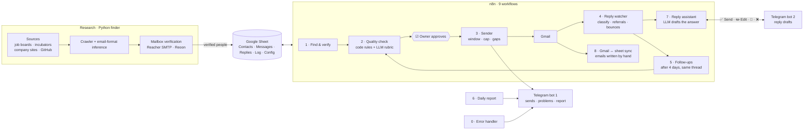
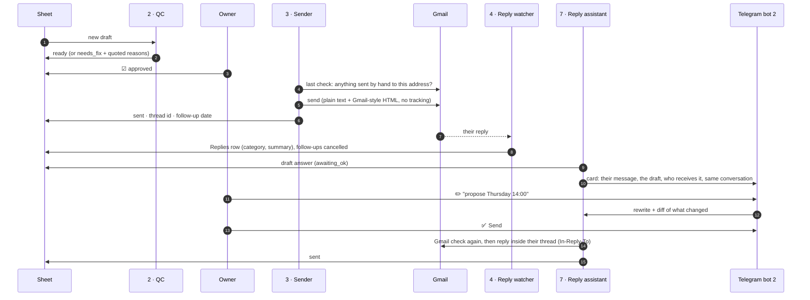
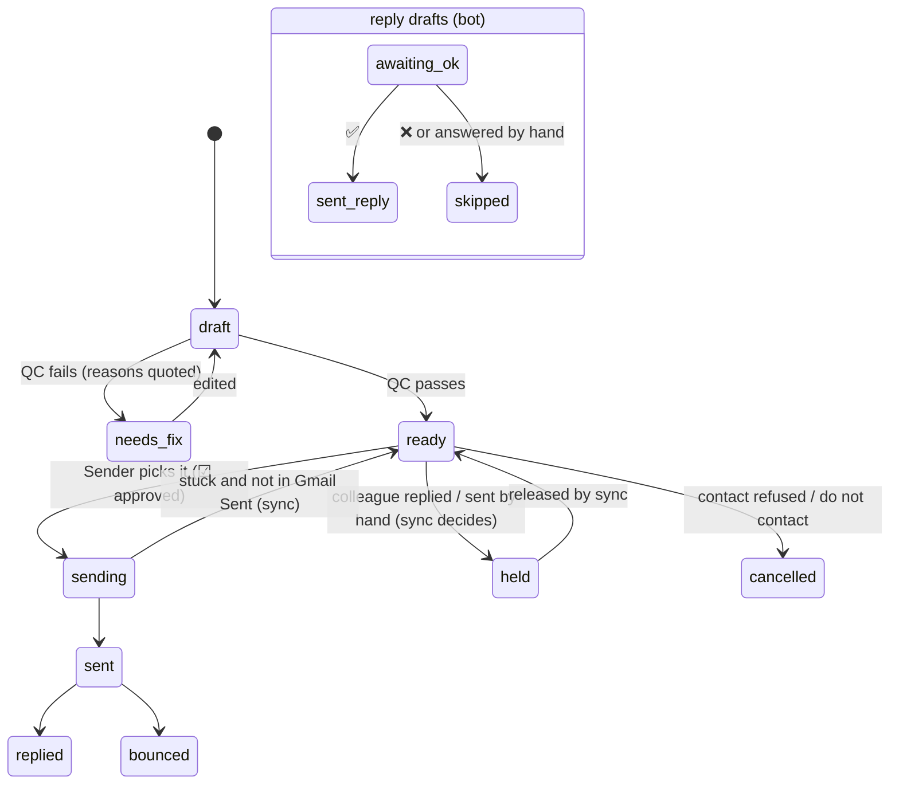

# ai-outreach-agent

**An AI agent that runs a targeted job search end to end, with a human in control of everything that leaves the outbox.**

It finds organisations and the right people in them, finds and verifies their email addresses, writes personalised
emails, checks every claim against the sender's real profile, sends on a safe schedule, reads the replies, drafts
answers on Telegram, and keeps one Google Sheet as the single source of truth, even when the owner also writes
emails by hand.

Built for a real search (a master's-thesis internship in AI in Skåne and Copenhagen) and in daily production use
since October 2026.

 
 

📄 **One-page summary:** [`docs/case_study.pdf`](docs/case_study.pdf)

> **Did you receive an email from me?** Then you have already seen this system at work. Your company and your name
> were found by the research step, your address was confirmed by your mail server, the email was drafted by an LLM,
> checked line by line against my real profile, and read and approved by me before it was sent. Answers to
> replies work the same way: drafted by the agent, approved by me.

---

## Accuracy (October 2026)

| Measure | Result |
|---|---|
| Bounce rate on cold emails | **under 0.5 %** (one address, published on a careers page, had been closed since) |
| People found whose address was confirmed by their own mail server | **68 %** |
| People held back because their domain accepts every address (catch-all) or could not be confirmed | 32 %, never sent automatically |
| Confirmed addresses that came from a company format inferred from real staff addresses | 49 % (39 % were published by the person or company, 7 % from Hunter) |
| Confirmed addresses where the plain SMTP check could not answer or was wrong (mostly Microsoft 365), settled by a second verifier | 19 % |
| Emails sent by the agent whose claims were checked against the sender's real profile | all of them: the Sender refuses any text changed since the check |

Accuracy came before volume: an address is only sent automatically when a mail server has confirmed the mailbox, and a
domain that accepts every address (catch-all) is detected first and skipped, so no "probably right" guess slips through.

## How it works



**Automated:** research, address finding and verification, drafting, quality control, scheduling, sending, reply
classification, follow-ups, answer drafting, bookkeeping.
**Human:** approving what gets sent (a tick in the sheet) and approving every answer (one button on Telegram).

## The life of one conversation



## Two Telegram bots, two jobs

| Bot | What it sends | When |
|---|---|---|
| **Bot 1 · operations** | each email sent, problems (Gmail refusal, quota, LLM outage, bounce, a send that was blocked as a duplicate) with a fix for each, and the daily report | live + 18:00 |
| **Bot 2 · reply assistant** | one card per reply with a ready answer. Buttons send, edit (reply with an instruction or your own text), regenerate or skip | when a reply arrives |

The **daily report** arrives as three messages at the same time:
1. **Emails sent today**: a table with time, company, receiver and address (emails written by hand are marked).
2. **Replies today**: who answered, company, the category the LLM gave the reply (for example question, referral, auto-reply or bounce) and a one-line summary.
3. **Day summary**: problems with a fix for each, pipeline numbers, last run of every workflow.

## Safety and deliverability

| Guard | How |
|---|---|
| Nothing leaves without approval | Sender needs ☑ `approved` and an unchanged text since QC (content hash). Reply drafts need ✅ on the newest card version. |
| Never twice | append-only Log + content hash + "same type to same address" check. Right before every send, a Gmail "Sent" search catches emails the owner wrote by hand that the sheet does not know yet. |
| Owner works by hand too | workflow 8 reads Gmail "Sent" every hour: hand-written emails are logged, the queued email they replace is marked sent, open reply drafts they answered are closed, stuck rows are repaired. |
| Gmail stays healthy | Mon–Fri window, daily cap, 5 min + random jitter between sends, one person per company per day, colleagues only if nobody there answered, auto-pause on any quota or credential error. |
| Gmail API quota | every workflow that reads Gmail runs in its own minute (see below); reads are batched; searches return ids only. |
| No invented claims | code rules (length, dates, placeholders, banned phrases, signature leaks, wrong names) plus an LLM that must quote the text for every finding and check each claim against the Profile facts. |
| Addresses | published address > verified company format > nothing. Only mailbox-confirmed addresses are `valid`; catch-all domains need explicit approval; shared inboxes are never used. |

**Minute map** (Europe/Stockholm). On 12 Oct 2026 a burst of thread reads in the same minute as a send triggered
Gmail's per-minute quota, so every Gmail reader now has its own slot:

| Minute of the hour | Workflow |
|---|---|
| :00 :05 :10 … (+ up to 60 s jitter) | 3 · Sender (one email per run) |
| :02 :17 :32 :47 | 4 · Reply watcher |
| :38 | 8 · Gmail ↔ sheet sync (skips the hour if a send is in progress) |
| every 5 min | 7 · Reply assistant drafter (no Gmail reads) |

## Message lifecycle



## How contacts are found and verified

Only public, professional sources and tools used within their terms. Details in [`finder/README.md`](finder/README.md).

| Step | Sources and tools |
|---|---|
| Which organisations | The Hub public API (every startup hiring in the region), incubator and science-park portfolios (Minc, Ideon, Hetch, Mindpark), funding news, university group pages, [JobTech](https://jobtechdev.se) open job-ad API (Arbetsförmedlingen) |
| Which person | company team, about and career "people" pages (for example Teamtailor), English job ads that name the hiring manager, Hunter Discover and domain search filtered to IT and senior roles |
| Which address | an address the person or company published > their own public GitHub commit address on the company domain > the company's format, inferred from other real staff addresses > common formats as a last resort |
| Is it real | DNS MX → one random address per domain first (catch-all triage) → self-hosted [Reacher](https://github.com/reacherhq/check-if-email-exists) SMTP mailbox check → [Reoon](https://www.reoon.com) for Microsoft 365 domains |

About half of the confirmed addresses follow a company format confirmed by the mail server, 39 % were published by
the person or company and 7 % came from Hunter. One lesson from production: Microsoft 365 throttles the second recipient in an
SMTP session, so a plain SMTP check can call a real mailbox "invalid". Those domains are re-checked with Reoon, which
recovered real addresses that would otherwise have been dropped.

## Design choices
- **The sheet is the database.** Readable by a person, n8n and Python. Columns are addressed by header name, and every
  workflow stops with a clear error if one is missing. Config switches (pause, dry run, test recipient, caps) live in
  a Config tab, so no redeploy is needed.
- **Code for rules, LLM for judgement.** Anything checkable (word counts, dates, names, placeholders) is code and
  cannot be hallucinated. The LLM (Gemini Flash, Groq fallback on any error) judges personalisation and claims.
- **Workflows as source code.** All 9 workflows are generated by `n8n/build.py` from plain JavaScript and Markdown
  prompts, so they are diffable, reviewable and tested before they reach the server.
- **Tested like software.** 172 end-to-end checks run every Code node against an anonymised sheet with mocked APIs,
  and new nodes are executed in a real n8n 2.42.4 container against a mock of every API before deployment.
- **AI coding agent with roles.** The project is operated together with Claude Code through role files (researcher,
  email writer, inbox triage, pipeline operator, n8n engineer). See [`docs/05_agent_roles.md`](docs/05_agent_roles.md).

## Repository

| Folder | What |
|---|---|
| [`n8n/`](n8n/) | The 9 workflows: `src/` (one JS file per workflow), `prompts/`, `build.py`, `tests/` |
| [`finder/`](finder/) | Python: crawl company sites, public GitHub commit metadata, infer each company's email format, verify mailboxes, sync with the sheet |
| [`research/`](research/) | Source collectors (for example every startup hiring in a region on The Hub) |
| [`server/`](server/) | Docker Compose for the self-hosted [Reacher](https://github.com/reacherhq/check-if-email-exists) SMTP verifier |
| [`docs/`](docs/) | Sheet schema, setup guide, test plan, service account, agent roles |
| `data/`, `private/` | Real contacts, research output and CV. **Git-ignored**, never published |

## Quick start
```bash
# n8n workflows
cd n8n && cp build_config.example.json build_config.json   # fill in sheet id, chat id, credential ids
python3 build.py && (cd tests && npm i) && node tests/e2e.test.js

# finder
cd finder && python3 -m venv .venv && .venv/bin/pip install -r requirements.txt && cp .env.example .env
.venv/bin/python -m finder scan ../demo/pool.demo.csv /tmp/scan.csv
```
Full setup: [`docs/02_setup_guide.md`](docs/02_setup_guide.md) · test plan: [`docs/03_test_plan.md`](docs/03_test_plan.md) ·
verifier: [`server/README.md`](server/README.md).

## Responsible use
Only public, professional sources (company websites, press, public GitHub metadata). No leaked databases, no
LinkedIn scraping. Mailbox checks never send mail. Every outgoing email is approved by a person; low-volume,
one-to-one, relevant emails are the whole point.
