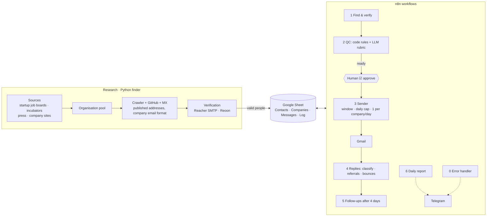

# ai-outreach-agent

An end-to-end outreach agent for a targeted job search: **find organisations → find the right people →
find and verify their email → draft a personalised email → LLM quality control → human approval → safe sending →
reply triage and follow-ups.**

Built for a real search (an AI master's-thesis internship in Skåne and Copenhagen). Every stage is automated
except the two that should stay human: approving what gets sent, and answering people.



## What's in the repo
| Folder | What |
|---|---|
| [`finder/`](finder/) | Python: crawl company sites, read public GitHub commit metadata, infer each company's email format, verify mailboxes, sync with the sheet |
| [`research/`](research/) | Source collectors (e.g. every startup hiring in a region on The Hub) |
| [`n8n/`](n8n/) | 7 n8n workflows generated from plain JS + prompts by `build.py`, plus an 85-check end-to-end test suite with mocked APIs |
| [`server/`](server/) | Docker Compose for the self-hosted [Reacher](https://github.com/reacherhq/check-if-email-exists) SMTP verifier |
| [`docs/`](docs/) | Sheet schema, setup, test plan, service account, agent roles |
| `data/`, `private/` | Real contacts, research output and CV. **Git-ignored**, never published |

## Design choices
- **Sheet as the database.** One Google Sheet is the source of truth, readable by a human, by n8n and by Python.
  Columns are always addressed by header name.
- **Deterministic rules in code, judgement in the LLM.** QC checks word counts, dates, banned phrases, placeholders,
  names and signature leaks in code. The LLM (Gemini Flash, Groq fallback) only judges personalisation and whether
  every claim is backed by the sender's profile facts, and it must quote the offending text.
- **Email quality over volume.** A published address beats an inferred company format, which beats a guess. Only
  mailbox-confirmed addresses are marked `valid`. Catch-all domains are `risky` and need explicit approval. Shared
  inboxes are never used.
- **Deliverability guards.** Mon–Fri sending window, daily cap, 5 min + jitter between emails, one person per
  company per day, a colleague only after a day with no reply, plain text with no tracking, and an automatic pause on
  bounces or quota errors.
- **Agent roles.** The AI coding agent works through role files (researcher, email writer, inbox triage,
  pipeline operator, n8n engineer) that share one context file. See [`docs/05_agent_roles.md`](docs/05_agent_roles.md).

## Quick start
```bash
# n8n workflows
cd n8n && cp build_config.example.json build_config.json   # fill in IDs
python3 build.py && (cd tests && npm i) && node tests/e2e.test.js

# finder
cd finder && python3 -m venv .venv && .venv/bin/pip install -r requirements.txt && cp .env.example .env
.venv/bin/python -m finder scan ../demo/pool.demo.csv /tmp/scan.csv
```
Full setup: [`docs/02_setup_guide.md`](docs/02_setup_guide.md) · verifier: [`server/README.md`](server/README.md).

## Responsible use
Only public, professional sources (company websites, press, public GitHub metadata). No leaked databases, no
LinkedIn scraping. Mailbox checks never send mail. Every outgoing email is reviewed and approved by a human, and
low volume, one-to-one, relevant emails are the whole point.
